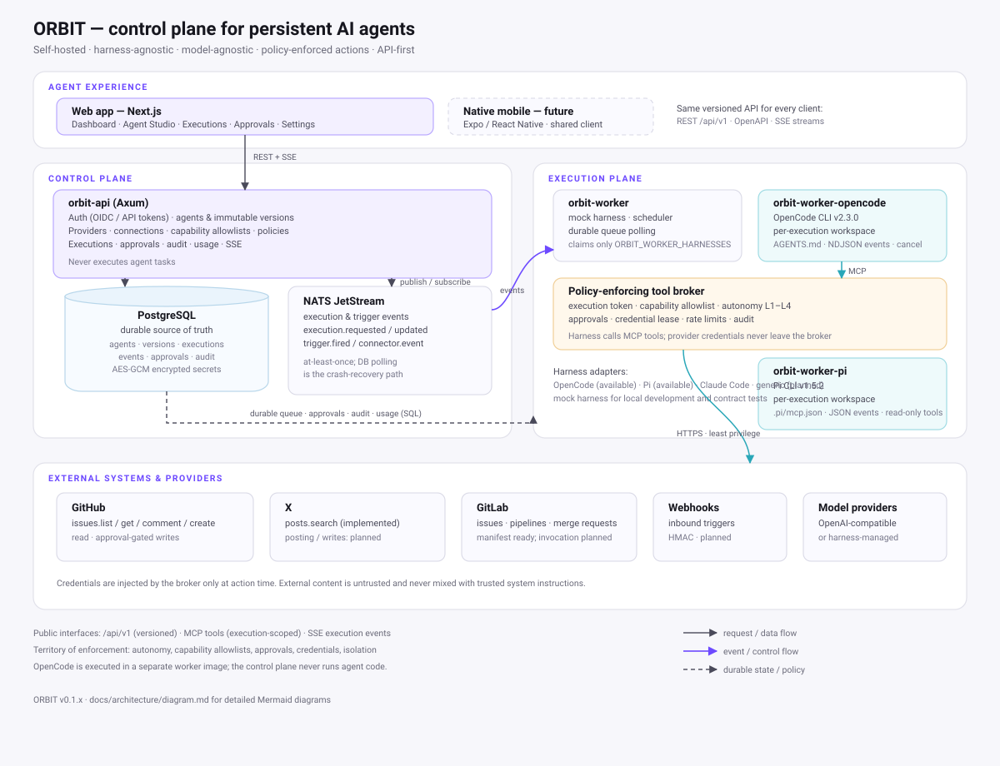
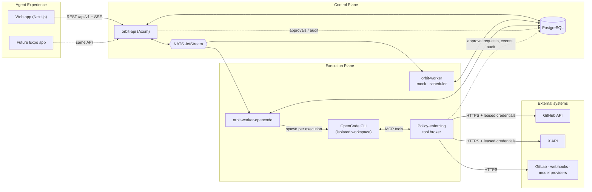
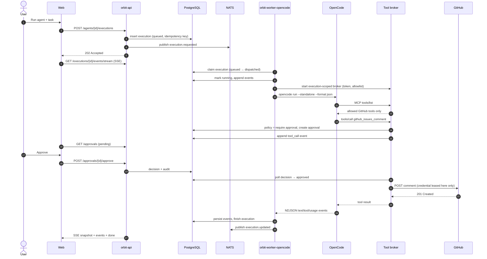
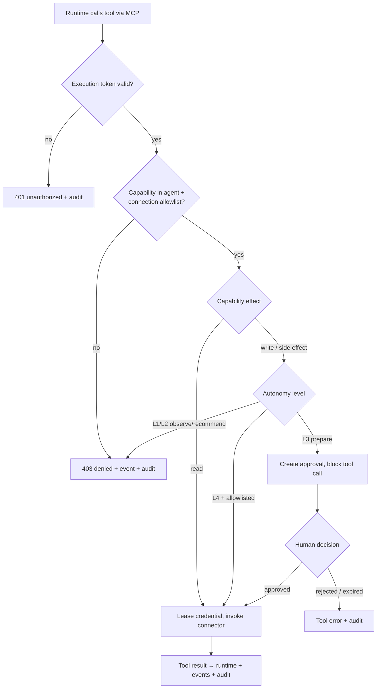
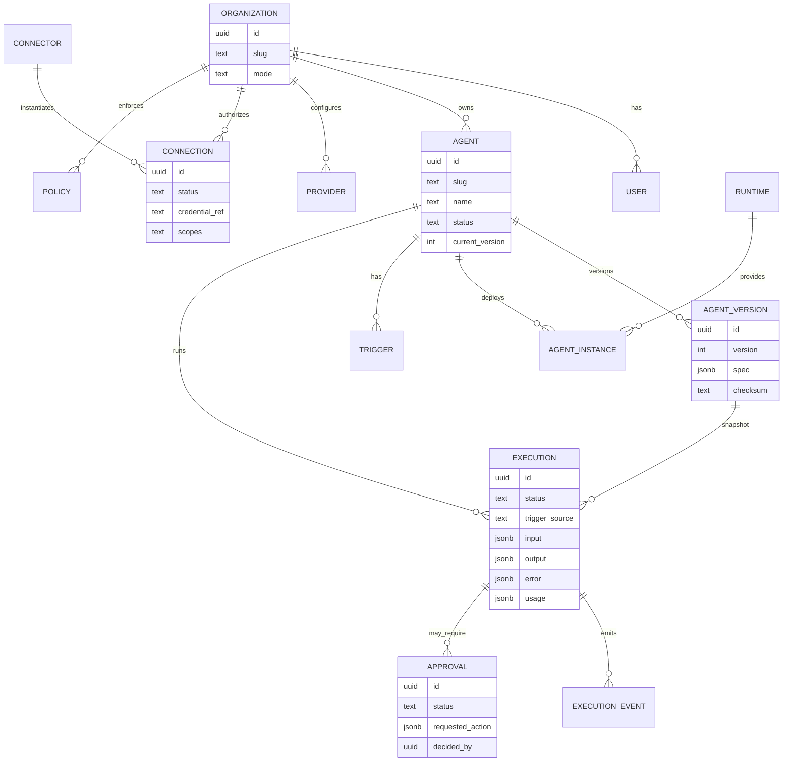
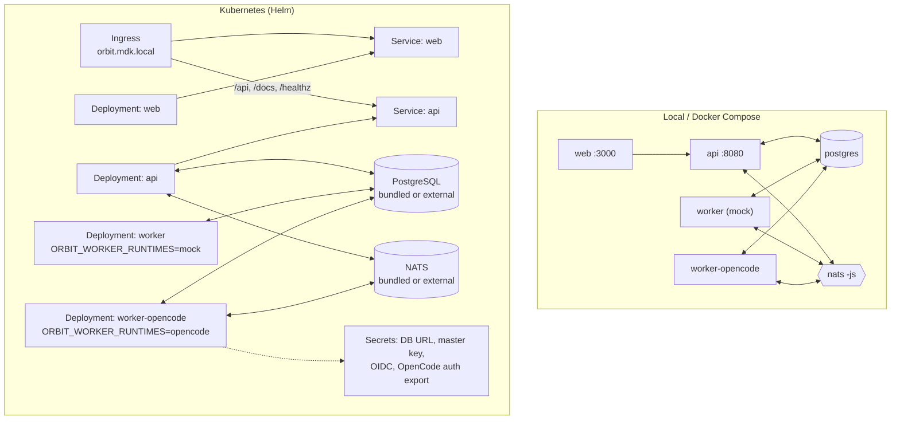

# ORBIT architecture diagrams

A high-resolution PNG is available at [`orbit-overview.png`](orbit-overview.png).

## Reading the diagram

| Layer | Responsibility |
|---|---|
| **Agent Experience** | Web UI (and future Expo app). Configuration, monitoring, approvals. No business logic or durable state. |
| **Control Plane** | `orbit-api`: auth, agents and immutable versions, providers, connections, executions, approvals, audit, SSE. PostgreSQL is the durable source of truth. NATS JetStream accelerates events; DB polling is the recovery path. |
| **Execution Plane** | `orbit-worker` (mock/scheduler) and `orbit-worker-opencode` (real OpenCode). Workers claim only their configured runtimes. The policy-enforcing tool broker runs per execution. |
| **External systems** | GitHub, X, GitLab, webhooks and model providers. All actions go through the broker; credentials never reach the runtime. |

| Status | Components |
|---|---|
| **Implemented** | API, PostgreSQL schema, NATS/memory bus, mock runtime, OpenCode v2.2.5, X read hydration, SSE, audit, encrypted secrets |
| **In progress** | Execution-scoped tool broker, GitHub capabilities, approval UI |
| **Planned** | GitLab actions, X posting, webhook verification, long-running service mode, swarm simulations, per-execution container isolation |

## System context

## Execution sequence (manual run with a GitHub write)

## Tool broker decision path

## Domain model

## Deployment topology

## Boundaries that keep the design honest

1. **The control plane never runs agent code.** Only workers and runtime containers do.
2. **PostgreSQL is the source of truth.** The event bus is an accelerator, not a queue you can lose.
3. **Policy and approvals live outside the model.** Prompts are not a security boundary.
4. **Credentials are leased by the broker per action**, never embedded in prompts, CLI arguments or tool output.
5. **Agent versions are immutable.** Running executions keep the version they started with.
6. **Workers are runtime-scoped.** The mock worker cannot claim OpenCode executions and vice versa.
7. **External content is untrusted.** Trusted instructions travel separately from retrieved data.
